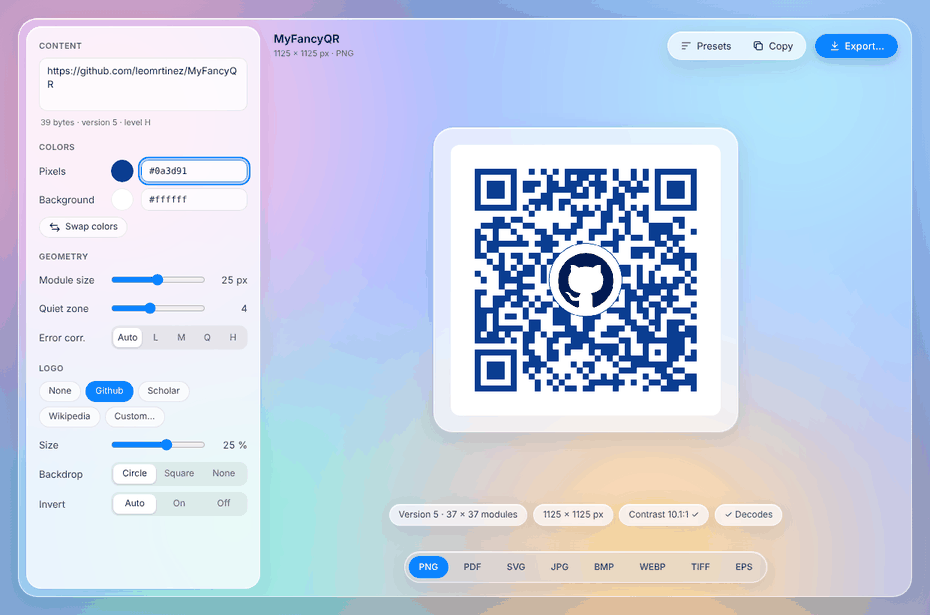
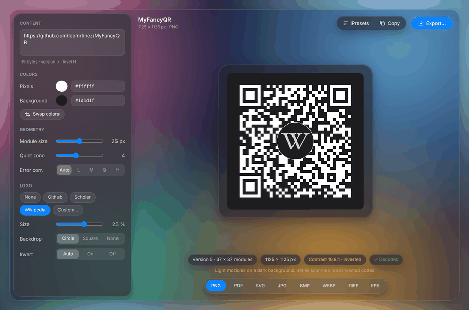

# 📷 MyFancyQR

MyFancyQR is a lightweight tool that generates fancy coloured QR codes from any text or URL, with an optional logo in the centre, and exports them to PNG, SVG, PDF, JPEG and more. Version 2 turns the original script into a small Python package with a reusable API and a macOS desktop app, while keeping every v1 command working.




> Looking for the original single-script version? It is preserved under the tag [`v1-final`](https://github.com/leomrtinez/MyFancyQR/tree/v1-final) and the branch [`v1`](https://github.com/leomrtinez/MyFancyQR/tree/v1).

## 📑 Table of Contents

- [Features](#-features)
- [Installation](#-installation)
- [Configuration](#️-configuration)
- [Usage](#-usage)
- [Desktop app](#️-desktop-app)
- [Python API](#-python-api)
- [Development](#-development)
- [Contributing](#-contributing)
- [License](#-license)
- [Contact](#-contact)

## ✨ Features

- Generate QR codes from any text or URL
- Export to PNG, SVG, PDF, JPEG, BMP, WEBP, TIFF or EPS; the format is inferred from the file extension
- Any CSS colour name or hex code for modules and background
- Centre logo (built-in or your own image), with size, backdrop shape and automatic inversion on dark backgrounds
- Vector SVG output that keeps colours, sizes and the logo
- Diagnostics: QR version, output size, contrast ratio, warnings, and an optional read-back check
- Desktop app with a live preview (macOS look, works in a browser too)
- Two dependencies for the CLI and API: `qrcode` and `Pillow`

## 📥 Installation

Clone the repository:

```bash
git clone git@github.com:leomrtinez/MyFancyQR.git
cd MyFancyQR
```

<details>
<summary>🐍 Using Conda</summary>

```bash
conda env create -f environment.yml
conda activate myfancyqr
```
</details>

<details>
<summary>📦 Using pip</summary>

```bash
python -m venv .venv && source .venv/bin/activate
pip install -e .              # CLI and Python API
pip install -e ".[gui]"       # + desktop app (pywebview)
pip install -e ".[scan]"      # + read-back check (OpenCV)
pip install -e ".[dev]"       # + test suite
```
</details>

Installing the package adds a `myfancyqr` command. Without installing, `python qr_generator.py ...` and `python -m myfancyqr ...` work from the repository root as long as `qrcode` and `Pillow` are available.

## ⚙️ Configuration

| Argument | Default | Description |
|---|---|---|
| `url` | this repository | Text or URL to encode |
| `output` | `qrcode` | Output file path; the extension selects the format |
| `-f`, `--format` | from extension, else `jpg` | Output format; overrides the extension |
| `-ls`, `--list-formats` | — | List supported output formats |
| `-bs`, `--box-size` | `25` | Size of one module, in pixels |
| `-bw`, `--border-width` | `1` | Quiet zone around the code, in modules (4 recommended by ISO/IEC 18004) |
| `-bc`, `--back-color` | `white` | Background colour: CSS name ([list](https://developer.mozilla.org/en-US/docs/Web/CSS/named-color)) or hex code |
| `-pc`, `--pixel-color` | `black` | Module colour: CSS name or hex code |
| `-ec`, `--error-correction` | `L`, or `H` with a logo | Error-correction level: `L`, `M`, `Q` or `H` |
| `-l`, `--logo` | none | Built-in logo name or path to an image |
| `--logo-size` | `25` | Logo size, in % of the code width (5–40) |
| `--logo-backdrop` | `circle` | Shape behind the logo: `circle`, `square` or `none` |
| `--invert-logo` | `auto` | Invert the logo colours: `auto` (on dark backgrounds), `always`, `never` |
| `--list-logos` | — | List built-in logos |
| `--check` | — | Decode the result to verify it (needs `opencv-python-headless`) |
| `-V`, `--version` | — | Print the version |

**Note:** if `back-color` is black and `pixel-color` is left black, the modules become white; likewise, white modules on the default white background switch the background to black.

Warnings (small quiet zone, low contrast, inverted colours, logo too large for the error-correction level) are printed on stderr; the code is still generated.

## 🚀 Usage

```bash
# Simplest use. Without an output name the file is called qrcode.jpg
python qr_generator.py https://example.com

# The extension selects the format
python qr_generator.py https://example.com file_name.png

# Force a format different from the extension (writes file_name.pdf)
python qr_generator.py https://example.com file_name.png --format pdf

# Hex colours, ISO quiet zone, vector output
python qr_generator.py https://example.com file_name.svg -pc '#0a3d91' -bc '#fff6e5' -bw 4

# Check that the result can be read back
python qr_generator.py https://example.com file_name.png -l Github --check
```

### 🖼️ Gallery

**Basic QR code**
```bash
python qr_generator.py https://example.com example/basic
```


**Colored QR code**
```bash
python qr_generator.py https://example.com example/basic_colored -bc orange -pc red
```


**QR code with logo**
```bash
python qr_generator.py https://example.com example/logo -l Github
```


**QR code with logo (inverted colors)**
```bash
python qr_generator.py https://en.wikipedia.org/wiki/QR_code example/qr_code_wiki_r --logo Wikipedia -bc black
```


### About logos

Built-in logos live in [`myfancyqr/logos/`](myfancyqr/logos); list them with `--list-logos` and use them by name (case-insensitive):

```bash
python qr_generator.py https://github.com/user/repo --logo Github
```

Any image Pillow can open works as a custom logo (PNG with transparency gives the best result); its aspect ratio is preserved:

```bash
python qr_generator.py https://en.wikipedia.org/wiki/QR_code --logo ~/Pictures/my_logo.png file_name.png
```

With a logo, the error correction defaults to `H` so the code stays readable. For best results, use a high-resolution image and keep the logo at 30 % of the width or less.

## 🖥️ Desktop app

```bash
pip install -e ".[gui,scan]"     # once (the conda environment already includes both)
python -m myfancyqr.gui          # or: myfancyqr-gui
```

The app shows a live preview as you edit the content, colours, module size, quiet zone, error correction and logo. Under the preview it reports the QR version, the output size in pixels, the contrast ratio and whether the code can be read back (with OpenCV installed), plus warnings when a setting makes the code harder to scan.

- **Export…** (⌘E) opens a save dialog in the format selected in the bottom bar.
- **Copy** (⇧⌘C) puts a full-resolution PNG on the clipboard.
- **Presets** saves the current style (everything but the content) and reapplies it later. Styles are stored in `~/Library/Application Support/MyFancyQR/presets.json`.
- The appearance follows the system light or dark mode.



The app is designed for macOS, where the window uses the system translucency and merges its title bar with the sidebar. If that window styling misbehaves on your macOS version, `--native-titlebar` keeps the standard title bar. pywebview also runs on Linux and Windows, without the translucency.

**Browser mode.** `python -m myfancyqr.gui --browser` serves the same interface on `http://127.0.0.1:8765` without pywebview; files are uploaded and downloaded instead of using native dialogs. It also works on a remote machine over SSH:

```bash
ssh -L 8765:127.0.0.1:8765 my-server                   # on your computer
python -m myfancyqr.gui --browser --no-open            # on the server
# then open http://127.0.0.1:8765
```

## 🐍 Python API

```python
from myfancyqr import QRConfig, analyse, render, save, to_svg

cfg = QRConfig(
    "https://example.com",
    fill_color="#0a3d91",
    back_color="white",
    box_size=20,
    border=4,
    logo="Github",
)

img = render(cfg)                    # PIL.Image.Image (RGB)
svg = to_svg(cfg)                    # SVG document as a string
path = save(cfg, "out/example.pdf")  # format from the extension
info = analyse(cfg)                  # version, size, contrast, warnings...
print(info.version, info.pixel_size, info.warnings)
```

## 🧪 Development

```bash
pip install -e ".[dev]"
pytest
```

The layout is:

```
myfancyqr/
├── core.py      # QRConfig, build_matrix, render, to_svg, save, analyse, decode_check
├── cli.py       # command-line interface (v1-compatible)
├── gui/         # desktop app: api.py (Python side), app.py (window), devserver.py (browser mode), static/
└── logos/       # built-in logos
qr_generator.py  # v1 entry point, kept for compatibility
tests/
```

See [CHANGELOG.md](CHANGELOG.md) for what changed since v1.

## 🤝 Contributing

Contributions are welcome! If you'd like to help improve MyFancyQR:

1. Fork the repository
2. Create a new branch (`git checkout -b feature/my-feature`)
3. Commit your changes (`git commit -m 'Add my feature'`)
4. Push to your branch (`git push origin feature/my-feature`)
5. Open a Pull Request

Please make sure to open an issue first for major changes, so we can discuss what you'd like to do.

## 📜 License

This project is licensed under the **GNU General Public License v3.0 (GPLv3)**.
See the [LICENSE](LICENSE) file for details.

## 📬 Contact

Maintained by [@leomrtinez](https://github.com/leomrtinez)   
📧 Email: [click_to_send@gmail.com](mailto:martinez.leo.work@gmail.com)   
🐞 For bugs or feature requests, please [open an issue](https://github.com/leomrtinez/MyFancyQR/issues).
